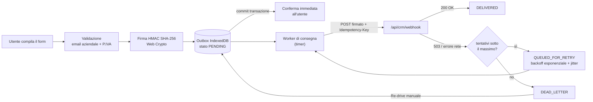
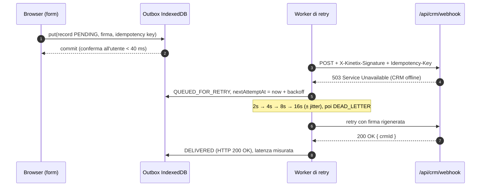

# TechPYRE Reference Architecture #2 — Infrastruttura Headless & Failover Coda Lead

> **Azienda fittizia a scopo dimostrativo — dati simulati in memoria / nessun dato reale.**
> Kinetix Robotics & Vision S.r.l. non esiste. Prodotti, prezzi, parametri ROI e ipotesi del benchmark sono valori di modello dichiarati, non risultati di clienti reali.

Reference Architecture progettata da **[TechPYRE](https://www.techpyre.eu) — Studio di Ingegneria del Software B2B** · Head of Studio: **Riccardo Granza**.

**Live Demo:** <https://headless-demo.techpyre.eu>

---

## Scenario

Kinetix Robotics & Vision S.r.l. (sede fittizia nel distretto meccatronico di Modena) progetta isole robotizzate di saldatura laser e sistemi di visione artificiale per il controllo qualità in linea. Il sito corporate era un WordPress con 24 plugin: TTFB oltre il secondo sotto carico, form sincrono verso il CRM e lead persi ogni volta che HubSpot/Salesforce andava in manutenzione o durante i picchi generati dalle campagne Google/LinkedIn Ads.

Questa reference architecture dimostra la sostituzione con:

- **landing headless pre-renderizzata** (SSG) servita dalla CDN Edge, interattività confinata in Client Components mirati;
- **pipeline dei lead asincrona** con Outbox persistente, retry con Exponential Backoff + jitter, Dead-Letter Queue, idempotenza e firma HMAC: zero lead persi anche con CRM offline.

## Funzionalità

| Modulo | Cosa dimostra |
| --- | --- |
| **TechPYRE Edge Inspector** | Barra di telemetria con metriche **reali** del browser: tempo di idratazione (`performance.now()` al mount), TTFB (`PerformanceNavigationTiming`), LCP (`PerformanceObserver('largest-contentful-paint')`), byte trasferiti del documento, stato connessione `ONLINE` / `CRM DOWN SIMULATION`. Collassabile su mobile. |
| **Configuratore ROI multi-step** | Settore, turni, pezzi/ora, tolleranza in micron, scarto attuale e costo pezzo → risparmio annuo, investimento, payback, effetto del credito d'imposta Transizione 5.0 con **aliquota stimata modificabile** e disclaimer. Formule esplicite nel "dettaglio calcolo". |
| **Form studio di fattibilità** | Rifiuto cortese dei domini webmail (gmail, hotmail, libero…), validazione formale della **P.IVA italiana con cifra di controllo** (algoritmo di Luhn), consenso privacy. |
| **Chaos & Failover Inspector** | Toggle "CRM HTTP 503", conferma all'utente misurata dopo la persistenza locale (obiettivo < 40 ms), payload salvato in IndexedDB, stati `PENDING` → `IN_FLIGHT` → `QUEUED_FOR_RETRY` → `DELIVERED (HTTP 200 OK)` / `DEAD_LETTER`, countdown del prossimo retry, Re-drive dalla DLQ, flush della coda, log stile terminale con timestamp ISO. |
| **Webhook CRM simulato** | Route Handler reale `POST /api/crm/webhook`: verifica firma HMAC SHA-256 e freschezza del timestamp, 503 in modalità chaos, deduplica per `Idempotency-Key`, 200 con id CRM. |
| **Benchmark Legacy CMS vs TechPYRE Edge** | Modello trasparente con tutte le ipotesi modificabili, calcolo passo-passo, lead/mese, CPA, budget sprecato, grafico a barre in puro CSS. |

## Architettura: Outbox + Retry + Dead-Letter Queue





### Scelte di progetto

- **Conferma dopo la persistenza, non dopo il CRM.** L'utente riceve la conferma quando la transazione IndexedDB è committata (`oncomplete`); la chiamata al CRM avviene in background. Il tempo di conferma è misurato con `performance.now()` e mostrato nell'interfaccia.
- **Outbox pattern anche con CRM online.** Ogni lead passa sempre dalla coda: un solo percorso di codice, testato in tutte le condizioni.
- **Exponential Backoff con jitter.** `ritardo(n) = min(30 s, 2 s × 2^(n−1))`, poi *equal jitter*: metà fissa e metà casuale. Il jitter distribuisce i retry di molti client ed evita il *thundering herd* quando il CRM torna disponibile. Dopo 5 tentativi il lead va in **Dead-Letter Queue**, da cui può essere rimesso in coda (Re-drive).
- **Idempotenza.** La chiave UUID v4 nasce con il lead e resta identica per tutti i tentativi: se un retry arriva dopo una consegna già avvenuta (es. risposta persa per timeout), il webhook restituisce lo stesso id CRM con `duplicate: true` invece di creare un duplicato.
- **Firma HMAC SHA-256.** Stringa firmata `${timestamp}.${body}`, header `X-Kinetix-Signature: sha256=<hex>` e `X-Kinetix-Timestamp`; il server verifica la firma con confronto a tempo costante e rifiuta timestamp fuori da una finestra di 5 minuti (protezione dal replay). La firma è rigenerata a ogni tentativo.
- **Resilienza alla chiusura della scheda.** Al riavvio i record rimasti `IN_FLIGHT` tornano `QUEUED_FOR_RETRY`; i lead non consegnati sopravvivono al reload della pagina.

### Cosa cambia in produzione

Questa sandbox mostra il pattern lato client per renderlo osservabile. In un sistema reale:

1. **Coda server-side durevole** in aggiunta alla persistenza client: il form invia a un endpoint Edge che scrive su una coda gestita (Vercel Queues, Upstash QStash/Redis, AWS SQS) e risponde subito `202 Accepted`; i worker consumano la coda con la stessa politica di retry e DLQ. La persistenza IndexedDB resta come ulteriore protezione in caso di rete assente lato utente.
2. **Segreto HMAC solo lato server**, in variabile d'ambiente, con rotazione. Nella demo la firma è calcolata nel browser, quindi il segreto è pubblico per costruzione.
3. **Deduplica su store condiviso** (Redis con TTL o vincolo di unicità a database) invece della `Map` in memoria per istanza.
4. **Osservabilità**: metriche su profondità della coda, età del messaggio più vecchio, tasso di DLQ, alert su DLQ non vuota; Real User Monitoring dei Core Web Vitals.
5. **Integrazione CRM reale** tramite API HubSpot/Salesforce con gestione dei rate limit (`429` + `Retry-After`).

## Impatto di TTFB e Core Web Vitals sul CPA nelle campagne B2B

Nelle campagne LinkedIn/Google Ads si paga il **click**, non la visita: ogni visitatore che abbandona prima che la pagina sia utilizzabile è budget speso senza alcuna possibilità di conversione. Un TTFB elevato ritarda tutto il resto (download di CSS e font, LCP, interattività); su mobile e su reti aziendali con proxy l'effetto è amplificato. A questo si sommano i lead persi quando il form fallisce per timeout del server o indisponibilità del CRM.

Il modello del benchmark (`src/lib/benchmark.ts`) è volutamente semplice e trasparente:

```
Lead consegnati = click × (1 − abbandono) × conversione form × tasso di consegna
CPA             = spesa ÷ lead consegnati
Budget sprecato = spesa × [abbandono + (1 − abbandono) × conversione × lead persi]
```

Il tasso di conversione del form è **identico** per entrambi gli stack (confronto equo, stesso budget e stesso copy). Con le ipotesi di default:

| Ipotesi | Legacy (WordPress + 24 plugin) | TechPYRE (Next.js SSG/Edge + Failover Queue) |
| --- | --- | --- |
| TTFB | 1,4 s | < 50 ms |
| LCP | 4,2 s | 0,3 s |
| Abbandono prima del caricamento | 42% | 8,5% |
| Lead persi (timeout, errori server/CRM) | 6% | 0% (consegna webhook 100%) |

il rapporto tra lead consegnati vale `0,915 / (0,58 × 0,94) ≈ 1,678`, cioè **+68% di lead a parità di spesa**, indipendentemente da click, CPC e conversione.

**Esempio numerico** — 3.000 click/mese, CPC medio 2,80 €, conversione del form 4%:

| | Legacy | Edge |
| --- | --- | --- |
| Spesa mensile | 8.400 € | 8.400 € |
| Lead consegnati | 3.000 × 0,58 × 0,04 × 0,94 = **65,4** | 3.000 × 0,915 × 0,04 × 1 = **109,8** |
| CPA | **128,39 €** | **76,50 €** (−40,4%) |
| Budget sprecato | 3.540 € | 714 € |

**Fonti e limiti.** Le ipotesi di default sono coerenti con l'ordine di grandezza di ricerche pubbliche — Google/SOASTA sull'abbandono delle visite mobile quando il caricamento supera circa 3 secondi, e lo studio Deloitte *"Milliseconds Make Millions"* sulla correlazione tra velocità del sito mobile e conversioni — ma **non sono dati di un cliente reale**. Ogni parametro è modificabile nel pannello "Ipotesi del modello" per tararlo sulla propria analytics.

## Stack

- **Next.js 16** (App Router, Turbopack), **React 19**, **TypeScript** `strict`
- **Tailwind CSS v4** (`@tailwindcss/postcss`), **lucide-react**
- Font via `next/font` (Inter + JetBrains Mono), illustrazioni in SVG inline, nessuna immagine raster
- Nessuna libreria di grafici, animazione o UI kit; API native: IndexedDB, Web Crypto, Performance API

La pagina `/` è prerenderizzata staticamente (`○ Static`); l'unica route dinamica è il Route Handler `/api/crm/webhook`.

## Avvio locale

Requisiti: Node.js ≥ 22.18 (consigliato 24+), npm.

```bash
npm install
npm run dev          # http://localhost:3000
npm run build        # build di produzione
npm run start        # serve la build
npm run lint         # ESLint (eslint-config-next)
npm run typecheck    # tsc --noEmit
npm test             # test unitari con node:test (type stripping TypeScript nativo)
```

I test (`tests/*.test.ts`) coprono le funzioni pure di `src/lib`: modello del benchmark (+68%), configuratore ROI, cifra di controllo della P.IVA e filtro webmail, backoff con jitter, transizioni di stato della coda/DLQ, firma e verifica HMAC.

### Prova del failover

1. Compila il form (il pulsante "Compila dati di esempio" inserisce una P.IVA formalmente valida).
2. Attiva **"Simula Disconnessione / Crash del CRM Aziendale"** e invia: la conferma arriva in pochi millisecondi, il lead passa a `QUEUED_FOR_RETRY` con countdown del prossimo tentativo.
3. Attendi ~30 secondi: dopo 5 tentativi falliti il lead finisce in `DEAD_LETTER`.
4. Premi **"Ripristina Connessione CRM & Esegui Flush della Coda"** e poi **Re-drive**: il lead risulta `DELIVERED (HTTP 200 OK)` con id CRM e latenza misurata.
5. Ricarica la pagina con lead in coda: vengono recuperati da IndexedDB e consegnati.

## Deploy su Vercel

```bash
npx vercel link --yes --project techpyre-headless-leadgen-reference
npx vercel --prod --yes
npx vercel domains add headless-demo.techpyre.eu techpyre-headless-leadgen-reference
```

Nessuna variabile d'ambiente richiesta. Il dominio personalizzato richiede un record `CNAME` presso il provider DNS, come indicato da `vercel domains inspect`.

## Struttura delle cartelle

```
src/
├── app/
│   ├── api/crm/webhook/route.ts   # Webhook CRM simulato (HMAC, 503 chaos, idempotenza)
│   ├── globals.css                # Tema Tailwind v4 "High-Tech Industrial"
│   ├── icon.svg
│   ├── layout.tsx                 # Font, metadata, lang="it"
│   └── page.tsx                   # Pagina statica: composizione delle sezioni
├── components/
│   ├── benchmark/                 # Simulatore Legacy vs Edge
│   ├── leads/                     # Form, Chaos & Failover Inspector, workbench
│   ├── marketing/                 # Hero, sezioni, footer, illustrazione SVG
│   ├── roi/                       # Configuratore ROI multi-step
│   ├── sandbox/                   # Provider di stato condiviso, Edge Inspector
│   └── ui/
├── data/                          # Dataset: Kinetix, ipotesi ROI e benchmark
├── hooks/                         # useLeadOutbox (worker), useTelemetry, useNow
├── lib/                           # Logica pura: roi, benchmark, backoff, queue, hmac, validation, format
└── types/                         # Interfacce TypeScript esportate
tests/                             # Test unitari node:test
```

## Licenza

[MIT](./LICENSE) © TechPYRE — Riccardo Granza · <https://www.techpyre.eu>
